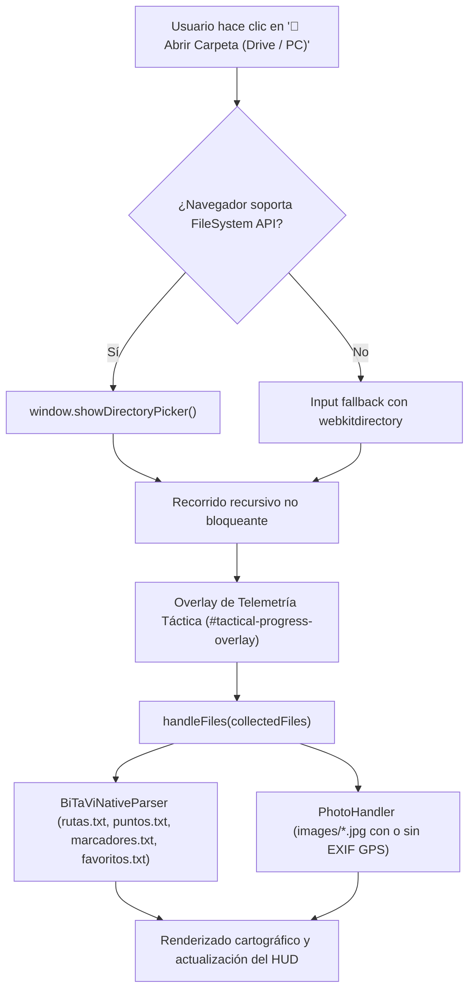

# BiTaVi PC - Ingestión Directa de Carpetas con FileSystem Access API

> **Documento Oficial del Sistema**: `docs/10_soporte_carpetas_filesystem_api.md`  
> **Versión del Sistema**: `v0.4.6-alpha`  
> **Fecha de Emisión**: 2026-10-17  
> **Estado**: Activo / Referencia Arquitectónica

---

## 1. Justificación y Objetivos

Hasta la versión `v0.4.5-alpha`, la ingesta de bitácoras de viaje requería:
1. Un archivo comprimido `.zip` procesado íntegramente en la memoria RAM mediante `JSZip`.
2. O bien la configuración de credenciales OAuth (Client ID) en Google Cloud Console para descargar backups desde Google Drive API v3.

Esta arquitectura presentaba dos inconvenientes operativos:
- **Sobrecarga de RAM**: La descompresión en el hilo principal de paquetes ZIP pesados con fotos en alta resolución generaba picos de memoria.
- **Fricción de configuración**: Para usuarios sin conocimientos técnicos, la creación de proyectos en Google Cloud representaba una barrera de entrada importante.

La solución introducida en la versión **`v0.4.6-alpha`** permite seleccionar directamente la carpeta física en disco donde Google Drive para PC (o el explorador de archivos local) sincroniza los datos, suprimiendo la necesidad de empaquetar en ZIP y prescindiendo de claves de API.

---

## 2. Arquitectura del Componente `FolderBackupLoader`

El módulo se encuentra encapsulado en [`src/components/folder-loader.js`](../src/components/folder-loader.js) y opera con dos estrategias concurrentes:

### 2.1. Estrategia Primaria: `window.showDirectoryPicker()`
- **Entorno**: Navegadores modernos basados en Chromium (Google Chrome, Microsoft Edge, Opera, Brave).
- **Mecanismo**: Invoca el selector nativo del sistema operativo en modo de solo lectura (`mode: 'read'`).
- **Recorrido Asíncrono**: Utiliza iteradores asíncronos (`for await (const entry of handle.values())`) para explorar el árbol de directorios de manera no bloqueante.
- **Indexación de Subcarpetas**: Identifica y etiqueta la procedencia de los archivos (por ejemplo `images/IMG_2026.jpg`) mediante la asignación controlada de la propiedad `relativePath`.

### 2.2. Estrategia de Fallback: HTML5 `webkitdirectory`
- **Entorno**: Navegadores sin soporte de FileSystem Access API (como Mozilla Firefox estándar o Safari).
- **Mecanismo**: Genera un elemento transitorio `<input type="file" webkitdirectory directory multiple>` que permite seleccionar una carpeta completa y procesa el array `FileList` resultante de manera equivalente.

---

## 3. Integración con el Flujo de Procesamiento (`handleFiles`)

El resultado obtenido por `FolderBackupLoader` (`{ folderName, files: File[] }`) se entrega directamente al enrutador central `handleFiles(files)` en [`src/main.js`](../src/main.js):

---

## 4. Ventajas Operativas

1. **Rendimiento Ultrarrápido**: La lectura se realiza a velocidad nativa de I/O de disco (NVMe / SSD / HDD), sin tiempo de descompresión ni sobrecarga de CPU por inflado de ZIPs.
2. **Compatibilidad con Google Drive Desktop**: Los usuarios con la aplicación oficial de Google Drive para Windows o Linux pueden abrir directamente la carpeta virtual (por ejemplo `G:\Mi Unidad\BiTaVi_Backups\`) sin descargar nada por HTTP.
3. **Privacidad Táctica (Cero Telemetría)**: Toda la lectura es 100% local en el cliente.
4. **Soporte Multiplataforma**: Funciona idénticamente en Windows y Linux.

---

## 5. Auditoría de Calidad y Verificación

- **Linter sintáctico**: Verificado con `scripts/check.js` (13/13 archivos OK).
- **Compilación de producción**: Verificado con `npm run build` (bundle generado en `dist/` sin advertencias).
- **Versionado sincronizado**: `v0.4.6-alpha`.
